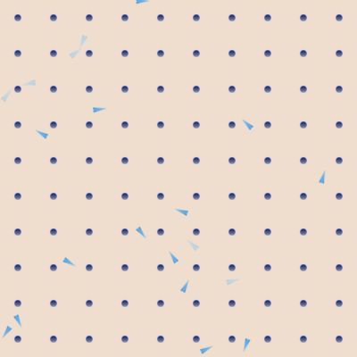
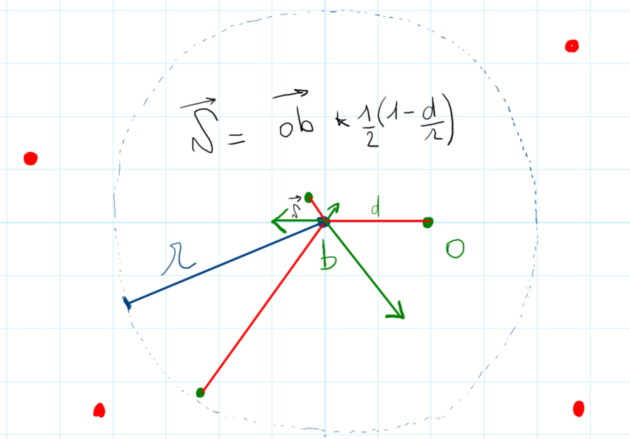
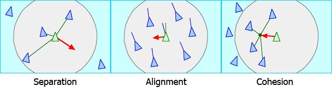

# T2 – Boids : une nuée d'objets

Les *boids* (de *bird-oid*, « qui ressemble à un oiseau ») sont une simulation imaginée par Craig Reynolds en 1986 : chaque oiseau décide de sa trajectoire en ne regardant que ses voisins proches, et pourtant le groupe, vu de loin, ressemble à une vraie nuée. Nous allons en écrire une version simple, où des flèches avancent, tournent et s'évitent sur un plateau d'obstacles.

L'objectif n'est pas la simulation parfaite : il s'agit d'écrire vos premières classes, et de découvrir une bibliothèque, **arcade**, qui ne se programme *que* par classes. Contrairement à pygame en T1, ce n'est plus vous qui écrivez la boucle de jeu : arcade l'a déjà, et c'est elle qui appelle vos méthodes.

D'après le TP « boids » de Thierry Parmentelat ([flotpython](https://python.info-mines.paris)), réécrit pour ce cours et pour arcade 3.



## Rendu

Ce TP se commence en séance et se termine chez vous, **individuellement**. À rendre dans le dossier `T2/` de votre dépôt `python-homework`, commité et poussé avant le **dimanche 1er novembre 2026, 23 h 59** (cf. <https://python.mines.prasquier.dev/rendre/>).

Ce qui est attendu : les étapes 0 à 9, des tests au vert (`uv run pytest`), et aucune remarque de `uv run ruff check .`. La partie « Pour aller plus loin » est facultative.

## Et l'IA ?

Même règle qu'en T1 : l'IA peut vous expliquer une erreur, une notion ou la doc d'arcade, mais **on ne copie jamais son code**. On comprend sa réponse assez bien pour réécrire le code soi-même, fenêtre de l'IA fermée. Complétion automatique coupée.

Attention, de plus : arcade a beaucoup changé avec sa version 3, et les IA comme les tutos en ligne proposent souvent l'ancienne syntaxe (`arcade.start_render()`, `sprite.draw()`…), qui ne marche plus. Le squelette et cet énoncé, eux, sont à jour.

## Mode d'emploi

Comme en T1, vous travaillez dans **un seul fichier**, `boids.py`, et vous faites un commit à chaque étape qui marche. Les tests (`tests/test_boids.py`) vérifient les classes et les fonctions du haut du fichier : gardez leurs noms et leurs paramètres. Au début, presque tout est rouge ; chaque étape en fait passer quelques-uns au vert.

## Étape 0 – On s'installe

Dézippez `T2-boids.zip` à la racine de votre dépôt `python-homework` : vous obtenez un dossier `T2/`. Ouvrez-le dans VS Code (*File → Open Folder*, le dossier `T2` lui-même), puis, dans le terminal intégré :

```bash
uv run boids.py
uv run pytest
```

Le premier `uv run` installe arcade : le `pyproject.toml` du TP le déclare déjà, pas besoin de `uv add`.

Une fenêtre s'ouvre, avec une petite flèche bleue immobile en bas à gauche : c'est notre premier boid. Un seul test passe : les autres tombent sur les `raise NotImplementedError("étape …")` du haut de `boids.py`, des trous que vous remplirez étape par étape. Choisissez l'interpréteur `.venv` du projet (`Ctrl+Shift+P` → *Python: Select Interpreter*), comme en T1, puis faites un premier commit.

💡 Dans arcade, l'origine (0, 0) est **en bas à gauche** de la fenêtre, et `y` monte vers le haut : c'est l'inverse de pygame.

## Étape 1 – Qui appelle qui ?

*Fait ensemble en séance.* Lisez la classe `MyWindow` : elle ne contient aucune boucle, et pourtant le jeu tourne. Pour comprendre qui fait tourner quoi :

1. ajoutez `print("on_update", delta_time)` dans `on_update`, et `print("on_draw")` dans `on_draw`. Combien de lignes par seconde ? Que vaut `delta_time` ?
2. dans `main()`, juste avant `arcade.run()`, ajoutez `print("avant run")` ; juste après, `print("après run")`. Quand s'affiche chacune de ces lignes ?
3. remplacez `MyWindow()` par `window = MyWindow()`, puis ajoutez `window.set_update_rate(1 / 2)` : que devient `delta_time` ?
4. cherchez, dans votre fichier, une ligne qui appelle `on_draw()`. La trouvez-vous ?

En clair, c'est `arcade.run()` qui contient la boucle de jeu : à chaque tour, c'est elle qui appelle `on_update`, puis `on_draw`, sur votre fenêtre. On ne les appelle jamais soi-même. Retirez ensuite les `print` et le `set_update_rate`.

## Étape 2 – Un boid qui avance

`arcade.Sprite` sait déjà beaucoup de choses : charger une image, la dessiner, la placer (`center_x`, `center_y`, ou les deux d'un coup avec `position`) et la tourner (`angle`, en degrés). Ce qu'il ne sait pas, c'est avancer tout seul, à la vitesse d'un oiseau, dans la direction où il pointe. Plutôt que de tout réécrire, nous allons donc **hériter** de `Sprite`, et ne lui ajouter que ce qui manque.

Complétez la classe `Boid(arcade.Sprite)` :

- `__init__(self, x, y, angle, speed=SPEED)` commence par appeler `super().__init__(ARROW, center_x=x, center_y=y, angle=angle)`, qui fait tout le travail de `Sprite`, puis range la vitesse dans un attribut `self.speed`, en pixels par seconde. Le paramètre `others` ne sert qu'à partir de l'étape 7 : ignorez-le pour l'instant ;
- `update(self, delta_time=1 / 60, *args, **kwargs)` fait avancer le boid de `speed × delta_time` pixels dans la direction où il pointe. Gardez cette signature : c'est exactement celle de `Sprite.update` (`*args, **kwargs` accepte d'éventuels arguments en plus, que l'on ignore ; on y reviendra). Pour le déplacement, partons de la formule « comme en maths » :

  ```python
  rad = math.radians(self.angle)
  self.center_x += self.speed * delta_time * math.cos(rad)
  self.center_y += self.speed * delta_time * math.sin(rad)
  ```

Dans `MyWindow.__init__`, remplacez le `Sprite` par un `Boid(100, 100, -30)`, et dans `on_update`, appelez `self.boids.update(delta_time)`. Le boid doit filer vers le haut et la droite, puis sortir de l'écran. Est-ce bien le cas ? Lancez aussi `uv run pytest`.

Le boid descend, et `test_boid_avance_vers_le_bas` est rouge ? C'est normal. Essayez `Boid(100, 100, 90)`, et regardez vers où pointe la flèche : on en parle en séance. Si vous travaillez seul, l'explication est dans les « Coups de pouce ».

**Question.** Vous n'avez écrit nulle part `boid.update(...)`. Qui l'appelle, et quand ?

Arcade.run appelle automatiquement on_update qui appelle boids.update à chaque tour.

## Étape 3 – En circuit fermé

Refermez le plateau sur lui-même : un boid qui sort à droite rentre à gauche, et de même en haut et en bas. Une seule opération suffit par coordonnée (indice : que vaut `810 % 800` ? et `-10 % 800` ?).

## Étape 4 – Plusieurs boids

Écrivez `random_boids(n, others=None)`, qui renvoie une liste de `n` boids placés et orientés au hasard sur le plateau (`random.uniform(a, b)` tire un nombre décimal entre `a` et `b`). Passez `others` à chaque boid (il servira à partir de l'étape 7).

Dans `MyWindow.__init__`, mettez les `N_BOIDS` boids dans la `SpriteList` (`self.boids.extend(...)`). Notez qu'aucune ligne de `on_update` ni de `on_draw` ne change : la liste appelle `update` et dessine chacun de ses éléments.

## Étape 5 – Le clavier, et un peu de bruit

Deux changements dans le cap des boids :

1. **le clavier** : tant que la flèche ← (resp. →) est enfoncée, tous les boids tournent à gauche (resp. à droite), à `TURN_SPEED` degrés par seconde. Pour cela, donnez à chaque boid un attribut `turning`, qui vaut `0` au départ, `-1` pour tourner à gauche et `+1` pour tourner à droite ; `update` ajoute alors `turning × TURN_SPEED × delta_time` à `self.angle`. Côté `MyWindow`, arcade appelle deux méthodes, que vous ajoutez :

   ```python
   def on_key_press(self, symbol, modifiers):
       ...  # symbol vaut arcade.key.LEFT, arcade.key.RIGHT, arcade.key.Q…

   def on_key_release(self, symbol, modifiers):
       ...
   ```

   Profitez-en pour quitter avec `q` (`self.close()`) ;
2. **le bruit** : à chaque `update`, le cap change d'un angle tiré au hasard entre `-NOISE` et `NOISE` degrés. Les trajectoires deviennent moins rectilignes, plus vivantes.

## Étape 6 – Des obstacles

Complétez `Obstacle(arcade.Sprite)`, dont le constructeur `Obstacle(x, y)` utilise l'image `OBSTACLE`. On pourrait s'en passer et prendre un simple `Sprite`, mais avoir sa propre classe permettra, plus tard, de distinguer un obstacle d'un boid.

Puis `obstacle_grid(n)`, qui renvoie `n × n` obstacles régulièrement espacés : avec `n = 10`, sur 800 pixels, un tous les 80 pixels, le premier à 40 pixels du bord. Affichez la grille de `GRID × GRID` obstacles dans une seconde `SpriteList`, dessinée avant les boids. Les boids, pour l'instant, passent à travers.

## Étape 7 – Les voisins

Écrivez la méthode `neighbours(self, others, radius=RADIUS)`, qui renvoie la liste des objets de `others` à moins de `radius` pixels du boid, **sauf le boid lui-même** (`other is not self`). `math.dist(self.position, other.position)` donne la distance entre deux sprites.

Pour la voir à l'œuvre, rendez le boid à moitié transparent quand il a au moins un voisin : l'attribut `alpha` d'un sprite va de 0 (invisible) à 255 (opaque).

Seulement voilà : dans `update`, le boid doit connaître `others`, la liste de tout ce qu'il faut éviter. Il y a deux façons de faire :

- une variable globale `EVERYTHING`, en haut du fichier, que `update` lit directement ;
- un attribut `self.others`, reçu par le constructeur (`others`, que vous avez ignoré jusqu'ici).

Réfléchissez aux avantages de chacune (pensez au jour où l'on voudra deux nuées, chacune avec ses obstacles). Les tests, eux, attendent la seconde : `Boid(..., others=...)` range `others` dans `self.others`, et une liste vide si `others` vaut `None`. Dans `MyWindow`, créez une seule liste, donnez-la à tous les boids, puis ajoutez-y les obstacles et les boids eux-mêmes.

**Question.** Pourquoi `others=None`, et pas `others=[]` dans les paramètres ? Et pourquoi les boids voient-ils les éléments ajoutés à la liste *après* leur création ?

## Étape 8 – La séparation

Voici enfin la règle qui donne vie à la nuée : chaque boid s'écarte de ses voisins trop proches.



Pour un boid en `b`, on ignore tout ce qui est plus loin que le rayon `r`. Pour chaque voisin `o`, à la distance `d`, on calcule le petit déplacement

$$\vec{\delta} = \vec{ob} \times \frac{1}{2}\left(1 - \frac{d}{r}\right)$$

qui éloigne `b` de `o`, dans la direction de `o` vers `b` : il est nul pour un voisin sur le cercle, et maximal pour un voisin à mi-rayon. On fait la somme de ces déplacements (en vert sur la figure), qu'on ajoute à celui dû à la vitesse.

Écrivez `separation(self, others, radius=RADIUS)`, qui renvoie cette somme sous la forme d'un tuple `(dx, dy)`, et appelez-la dans `update`. Les boids doivent maintenant contourner les obstacles, et s'éviter entre eux. Commit !

## Étape 9 – Un ciel au coucher du soleil

Le fond uni, c'est un peu triste. Le dossier `media/` contient `sky.png`, un ciel de 800 × 800 pixels, et le haut de `boids.py` le désigne déjà : `SKY`.

Un décor, c'est un sprite comme un autre : une image, posée au centre de la fenêtre. Dans `MyWindow.__init__`, créez une troisième `SpriteList`, `self.sky`, qui ne contient qu'un `Sprite` de l'image `SKY`, centré en (`WIDTH / 2`, `HEIGHT / 2`). Dans `on_draw`, dessinez-la avant les obstacles et les boids : ce qui est dessiné en dernier passe devant. Essayez l'inverse, pour voir.

Puis trouvez votre propre décor : une image libre de droits (un ciel, une mer, une forêt…), rangée dans `media/`, et désignée par `SKY`. Si elle n'a pas la taille de la fenêtre, donnez à votre sprite `width = WIDTH` et `height = HEIGHT`. Choisissez-la assez claire, ou assez unie, pour que les flèches restent visibles. Ajoutez l'image au commit (`git add media/`).

Pour finir, vérifiez que tout est propre :

```bash
uv run pytest          # tout doit être vert
uv run ruff check .    # aucune remarque
```

Un dernier commit, et un `git push` !

## Coups de pouce

À ne lire qu'après plusieurs minutes bloqués.

- **`AttributeError: 'Boid' object has no attribute 'sprite_lists'`** (ou `_position`, ou un autre attribut au nom étrange) : vous avez oublié `super().__init__(...)`, ou vous l'appelez après avoir touché à `self.center_x`. Il vient en premier.
- **`TypeError: Boid.update() takes 1 positional argument but 2 were given`** : il manque `delta_time` dans la signature de `update`. La `SpriteList` l'appelle avec le temps écoulé.
- **Le boid ne bouge pas**, sans erreur : vérifiez que `on_update` appelle bien `self.boids.update(delta_time)`, et que votre méthode s'appelle exactement `update`. Une faute de frappe dans un nom de méthode ne provoque aucune erreur : arcade appelle la méthode d'origine, qui ne fait rien.
- **Les boids tournent tous en même temps quand on appuie sur une flèche** : c'est voulu.
- **Étape 2, le boid descend.** Dans arcade, `y` monte vers le haut, comme en maths (en S1, avec pygame, il descendait), mais l'angle tourne dans le sens des aiguilles d'une montre : à 90°, la flèche pointe vers le bas. Un seul signe est donc à changer dans la formule : celui de `center_y`.
- **Étape 3.** En Python, `-10 % 800` vaut `790`.

## Pour aller plus loin

- les touches ↑ et ↓ pour accélérer et ralentir tous les boids ;
- orienter la flèche dans la direction où le boid se déplace vraiment, séparation comprise (`math.atan2`), puis lisser ces changements de cap ;
- un clic de souris (`on_mouse_press`) qui ajoute un obstacle, un clic droit qui en retire un ;
- les deux autres règles de Reynolds, l'**alignement** (aller dans la même direction que ses voisins) et la **cohésion** (se rapprocher du centre de ses voisins), avec des touches pour activer ou couper chaque règle :

  

- un boid de tête, d'une autre couleur, le seul que pilote le clavier, et que les autres suivent.

Pour en savoir plus : [la page de Craig Reynolds](https://www.red3d.com/cwr/boids/), et la [doc d'arcade](https://api.arcade.academy/).

Pour toute question, posez-la depuis votre lien personnel (« Poser une question »), ou en début de séance.
